# ASignX Current ER Schema

Updated 8 November 2026. Generated from the current Drizzle application schema: **23 application tables, 138 application fields and 41 foreign keys**. `auth_users` represents the external Supabase `auth.users` table and is not included in the application table count.

[PNG image](ER-Schema.png) · [Zoomable SVG](ER-Schema.svg) · [Mermaid source](ER-Schema.mmd) · [PlantUML source](Normalized-ERD.uml.txt) · [Data dictionary](Data-Dictionary.md)

The image includes all fields and declared FK relationships. Crow’s-foot endpoints describe the cardinality allowed by keys and nullability; they do not promise that every parent has a child. Composite FKs are one relationship, even when they include two fields. Partial unique indexes and trigger rules are documented in the dictionary, rather than represented as unconditional cardinalities. PNG and SVG are rendered from the PlantUML source using its bundled Smetana layout. The Mermaid source may use different placement.

## Editable diagram

```mermaid
erDiagram
    auth_users {
        uuid id PK "required"
    }
    profiles {
        uuid id PK,FK "required"
        varchar(100) display_name "required"
        varchar(10) role "required"
        varchar(64) timezone "required"
        timestamptz created_at "required"
        timestamptz updated_at "required"
    }
    signs {
        uuid id PK "required"
        varchar(100) gloss UK "required"
        text meaning "required"
        varchar(60) category "optional"
        text instructions "optional"
        text demo_path "optional"
        boolean is_published "required"
        timestamptz created_at "required"
    }
    courses {
        uuid id PK "required"
        varchar(150) title "required"
        text description "optional"
        integer cover_size "required"
        integer cover_angle "required"
        integer cover_density "required"
        varchar(3) cover_weight "required"
        varchar(12) cover_font "required"
        varchar(32) cover_text "required"
        varchar(12) cover_style "required"
        varchar(12) cover_tone "required"
        boolean is_published "required"
        timestamptz created_at "required"
    }
    lessons {
        uuid id PK "required"
        uuid course_id FK "required"
        varchar(150) title "required"
        text content "optional"
        integer sort_order "required"
        integer xp_reward "required"
        boolean is_published "required"
    }
    lesson_signs {
        uuid lesson_id PK,FK "required"
        uuid sign_id PK,FK "required"
        integer sort_order "required"
    }
    exercises {
        uuid id PK "required"
        uuid lesson_id FK "required"
        varchar(16) answer_type "required"
        text prompt "required"
        uuid sign_id FK "optional"
        integer sort_order "required"
    }
    exercise_options {
        uuid id PK "required"
        uuid exercise_id FK "required"
        text option_text "required"
        boolean is_correct "required"
        integer sort_order "required"
    }
    enrollments {
        uuid id PK "required"
        uuid user_id FK "required"
        uuid course_id FK "required"
        timestamptz enrolled_at "required"
    }
    lesson_progress {
        uuid enrollment_id PK,FK "required"
        uuid lesson_id PK,FK "required"
        timestamptz perfected_at "optional"
        timestamptz started_at "required"
        timestamptz completed_at "optional"
    }
    exercise_attempts {
        uuid id PK "required"
        uuid enrollment_id FK "required"
        uuid exercise_id FK "required"
        text response_text "optional"
        numeric(6__5) recognition_confidence "optional"
        uuid model_version_id FK "optional"
        uuid selected_option_id FK "optional"
        boolean is_correct "required"
        timestamptz attempted_at "required"
    }
    learner_hearts {
        uuid user_id PK,FK "required"
        integer hearts "required"
        timestamptz regenerated_at "required"
    }
    lesson_runs {
        uuid id PK "required"
        uuid enrollment_id FK "required"
        uuid lesson_id FK "required"
        boolean replay "required"
        timestamptz started_at "required"
        timestamptz completed_at "optional"
        boolean perfect "required"
    }
    lesson_run_questions {
        uuid run_id PK,FK "required"
        uuid exercise_id PK,FK "required"
        integer xp_value "required"
        integer sort_order "required"
        uuid attempt_id FK "optional"
    }
    xp_awards {
        uuid id PK "required"
        uuid enrollment_id FK "required"
        uuid lesson_id FK "required"
        uuid run_id FK "optional"
        uuid exercise_id FK "optional"
        varchar(20) source "required"
        integer amount "required"
        timestamptz awarded_at "required"
    }
    heart_practice_rounds {
        uuid id PK "required"
        uuid user_id FK "required"
        timestamptz completed_at "optional"
        timestamptz created_at "required"
    }
    heart_practice_questions {
        uuid round_id PK,FK "required"
        integer question_index PK "required"
        uuid exercise_id FK "required"
    }
    heart_practice_submissions {
        uuid id PK "required"
        uuid round_id FK "required"
        integer question_index FK "required"
        uuid selected_option_id FK "required"
        boolean is_correct "required"
        timestamptz submitted_at "required"
    }
    model_versions {
        uuid id PK "required"
        varchar(50) version UK "required"
        varchar(128) fingerprint UK "optional"
        text artifact_path "optional"
        numeric(6__5) confidence_threshold "required"
        timestamptz created_at "required"
    }
    practice_attempts {
        uuid id PK "required"
        uuid user_id FK "required"
        uuid lesson_id FK "optional"
        uuid target_sign_id FK "required"
        uuid predicted_sign_id FK "optional"
        uuid model_version_id FK "required"
        numeric(6__5) confidence "required"
        boolean is_correct "required"
        timestamptz attempted_at "required"
    }
    recognition_sessions {
        uuid id PK "required"
        uuid user_id FK "required"
        timestamptz started_at "required"
        timestamptz ended_at "optional"
        text final_text "optional"
    }
    recognition_results {
        uuid id PK "required"
        uuid session_id FK "required"
        uuid sign_id FK "optional"
        uuid model_version_id FK "required"
        integer sequence_no "required"
        numeric(6__5) confidence "required"
        timestamptz recognized_at "required"
    }
    achievements {
        uuid id PK "required"
        varchar(50) code UK "required"
        varchar(100) name "required"
        text description "required"
        varchar(25) metric "required"
        integer threshold "required"
    }
    user_achievements {
        uuid user_id PK,FK "required"
        uuid achievement_id PK,FK "required"
        timestamptz unlocked_at "required"
    }
    auth_users ||--o| profiles : "id"
    courses ||--o{ lessons : "course_id"
    lessons ||--o{ lesson_signs : "lesson_id"
    signs ||--o{ lesson_signs : "sign_id"
    lessons ||--o{ exercises : "lesson_id"
    signs |o--o{ exercises : "sign_id"
    exercises ||--o{ exercise_options : "exercise_id"
    profiles ||--o{ enrollments : "user_id"
    courses ||--o{ enrollments : "course_id"
    enrollments ||--o{ lesson_progress : "enrollment_id"
    lessons ||--o{ lesson_progress : "lesson_id"
    enrollments ||--o{ exercise_attempts : "enrollment_id"
    exercises ||--o{ exercise_attempts : "exercise_id"
    model_versions |o--o{ exercise_attempts : "model_version_id"
    exercise_options |o--o{ exercise_attempts : "exercise_id_selected_option_id"
    profiles ||--o| learner_hearts : "user_id"
    enrollments ||--o{ lesson_runs : "enrollment_id"
    lessons ||--o{ lesson_runs : "lesson_id"
    lesson_runs ||--o{ lesson_run_questions : "run_id"
    exercises ||--o{ lesson_run_questions : "exercise_id"
    exercise_attempts |o--o{ lesson_run_questions : "attempt_id"
    enrollments ||--o{ xp_awards : "enrollment_id"
    lessons ||--o{ xp_awards : "lesson_id"
    lesson_runs |o--o{ xp_awards : "run_id"
    exercises |o--o{ xp_awards : "exercise_id"
    profiles ||--o{ heart_practice_rounds : "user_id"
    heart_practice_rounds ||--o{ heart_practice_questions : "round_id"
    exercises ||--o{ heart_practice_questions : "exercise_id"
    exercise_options ||--o{ heart_practice_submissions : "selected_option_id"
    heart_practice_questions ||--o{ heart_practice_submissions : "round_id_question_index"
    profiles ||--o{ practice_attempts : "user_id"
    lessons |o--o{ practice_attempts : "lesson_id"
    signs ||--o{ practice_attempts : "target_sign_id"
    signs |o--o{ practice_attempts : "predicted_sign_id"
    model_versions ||--o{ practice_attempts : "model_version_id"
    profiles ||--o{ recognition_sessions : "user_id"
    recognition_sessions ||--o{ recognition_results : "session_id"
    signs |o--o{ recognition_results : "sign_id"
    model_versions ||--o{ recognition_results : "model_version_id"
    profiles ||--o{ user_achievements : "user_id"
    achievements ||--o{ user_achievements : "achievement_id"
```

## Current persistence boundaries

- Profiles hold learner or admin authorization; Supabase Auth owns identities and credentials.
- Courses store cover settings. Lessons, signs and exercises supply published learning content.
- Enrollment progress stores milestones; lesson runs snapshot question order and XP allocation. `xp_awards` is the single XP ledger. Heart practice uses relational question and submission tables, without duplicated JSON or correct-count fields.
- Model versions identify recognition evidence. `practice_attempts`, recognition session/result tables and achievement tables are schema capabilities; standalone persisted practice, saved Live history and automatic achievement awarding are not implemented end to end. Current Live text history remains in browser memory.
- Curated demonstration media uses Storage object paths. Model files belong to the recognition deployment. Camera frames and raw recordings are not columns in this schema.

This is a source-based schema snapshot, not a live Supabase introspection. See the dictionary for keys, defaults, checks, deletion rules and application validation.
