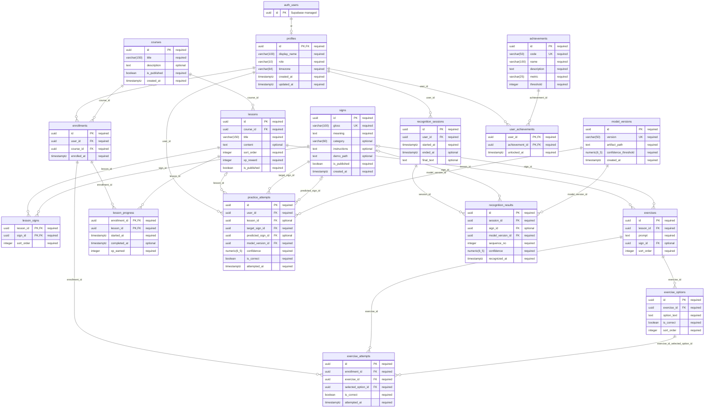

# ASignX — ER Schema

A simplified proposed database for ASignLive and ASign Learn: **16 application tables**, with Supabase Auth managing authentication. This replaces the earlier expanded proposal.

## Editable ER diagram

## Relationships

| Relationship | Cardinality |
|---|---|
| Supabase identity → profile | One identity has at most one profile; each profile requires one email-confirmed identity. Pending signups have no profile. |
| Course → lessons | One course has zero or more lessons; each lesson belongs to one course. |
| Lessons ↔ signs | Many-to-many through lesson_signs. |
| Lesson → exercises → options | Each exercise is one multiple-choice question with several answer options. |
| Learners ↔ courses | Many-to-many through enrollments. |
| Enrollment → progress and exercise attempts | Learning activity belongs to one learner/course enrollment. |
| Learner → practice attempts | Each attempt has a target sign and model; a predicted sign and lesson context are optional. |
| Learner → recognition sessions → results | Saved Live history contains ordered predictions; a recognized sign may be unknown. |
| Learners ↔ achievements | Many-to-many through user_achievements. |

## Scope decisions

- A profile has the learner or admin role. Guests have no stored profile, and ML developers operate the model service without requiring another application role.
- Each exercise is a single multiple-choice question. Several exercises form the lesson quiz; camera-based practice uses practice_attempts. A separate quiz/question hierarchy is unnecessary.
- Signs hold a simple category label and one optional demonstration-video path. Lesson text plus linked sign demonstrations supply the learning content.
- Lesson completion stores its one-time xp_earned. Total XP is calculated from completed lessons; no XP balance or transaction table is needed for this policy.
- Streaks are calculated from distinct local dates of lesson completion and successful practice, using profiles.timezone. No streak table or cache is needed.
- Model versions identify which model produced each practice/Live result. Separate deployment, evaluation, audit, role-assignment, and per-model vocabulary tables are outside this baseline.
- Save authenticated Live history only with user opt-in. Guest and unsaved sessions stay transient. Store curated media/model files in Supabase Storage, and only object paths in PostgreSQL. Do not store camera frames or raw video.

PK = primary key; FK = foreign key; UK = single-column unique key. Composite uniqueness, checks, and backend validation rules are specified in [Data Dictionary](Data-Dictionary.md). `auth_users` represents external `auth.users`; it is not an additional application table. Numeric diagram notation uses an underscore for scale; the dictionary supplies exact PostgreSQL types.
